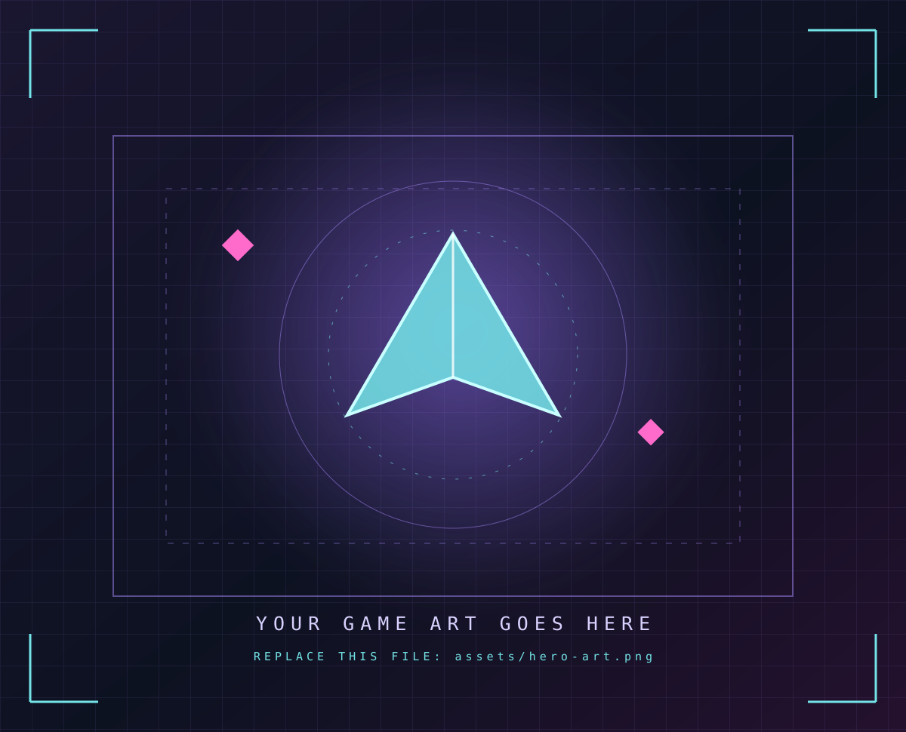

# NEON VOID

  

<strong>CO-OP SURVIVAL · TOP-DOWN ARENA SHOOTER · WINDOWS x64</strong>

  <a href="https://github.com/skysoftly/neuro_game/releases/latest">⬇ Скачать последнюю версию</a> ·
  <a href="https://skysoftly.github.io/neuro_game/">Открыть сайт</a> ·
  <a href="https://github.com/skysoftly/neuro_game/actions">Сборки</a>

---

**Арена уже проснулась.** Собери команду, переживи волну за волной, побеждай боссов и собирай собственный билд из улучшений. NEON VOID — кооперативный арена-шутер с ретро-эстетикой и игрой по локальной сети.

> **Платформа:** Windows 10/11, x64. Игра для ПК; веб- и Android-версий нет.

## Актуальный релиз — v0.2.1

*Обновлено: 19 ноября 2026 года.*

**NEON VOID v0.2.1** — актуальная Windows x64-сборка. В этой версии настройки и статистика вынесены в пользовательскую папку данных Windows: они не лежат рядом с EXE и не теряются при замене сборки. Статистика сохраняет количество матчей, суммарные убийства, лучший счёт и лучшую волну.

## Быстрый старт

1. Открой [последний релиз (v0.2.1)](https://github.com/skysoftly/neuro_game/releases/latest).
2. Скачай **NEON VOID.exe**.
3. Запусти игру. Если Windows Firewall запросит доступ, разреши подключение для частной сети.

Для готовой EXE-сборки не нужно отдельно устанавливать Python или Pygame.

## Что тебя ждёт

| | Возможность | Детали |
|---|---|---|
| ∞ | **Волны врагов** | Давление растёт с номером волны и количеством игроков. |
| ✳ | **Боссы** | Пять боссов с отдельными паттернами атак. |
| ⌁ | **Улучшения** | 17 улучшений; выбор после каждой волны и отдельная награда за босса. |
| ⌘ | **Кооператив** | До 12 игроков по TCP в одной локальной сети. |
| ◇ | **Противники** | Девять обычных типов врагов с разным поведением и атаками. |
| ▧ | **Атмосфера** | Ретро-интерфейс, CRT-эффекты, музыка и сетевые звуковые события. |

Дополнительно: общая пауза под управлением хоста, настройки музыки и эффектов, тряски экрана и лимита FPS, индивидуальная обратная связь по полученному урону.

## Играть вместе по LAN

1. Подключите все компьютеры к одной локальной сети.
2. На одном компьютере нажмите **«Создать лобби»**.
3. Передайте друзьям IP-адрес хоста, показанный в лобби.
4. Остальные выберите **«Подключиться по IP»** и введите этот адрес.
5. Когда команда будет готова, хост запускает игру.

**Сетевой порт:** TCP **5555**. Если брандмауэр Windows спросит разрешение, разрешите входящие подключения в частной сети. Порт фиксированный — вводить его отдельно не нужно.

## Управление

| Действие | Клавиши |
|---|---|
| Движение | WASD / стрелки |
| Прицел | Мышь |
| Стрельба | Левая кнопка мыши |
| Рывок | Space / Left Shift |
| Щит | Правая кнопка мыши / E |
| Пауза и продолжение | P / Escape (только хост) |
| Полный экран | F11 |
| Отладочная панель | F3 |

Между волнами выбери одну карточку улучшения. Следующая волна начнётся после выбора всеми живыми игроками.

## Настройки

Открой **«Настройки»** в главном меню. Можно отдельно настроить громкость музыки и эффектов, включить или отключить тряску экрана, выбрать ограничение 60, 120, 144 FPS или без ограничения. Настройки и статистика хранятся отдельно от папки игры в пользовательской папке данных: `%APPDATA%/NEON VOID/` на Windows. В `config.json` сохраняются настройки, а в `stats.json` — число матчей, суммарные убийства, лучший счёт и лучшая волна.

## Сборка Windows EXE из исходников

Для сборки рекомендуется **Python 3.12 x64**. Из корня проекта запусти файл **build.bat**.

Скрипт выберет Python 3.12, установит зависимости, создаст иконку и соберёт EXE через PyInstaller. Готовый файл появится здесь:

    dist/NEON VOID.exe

Ручная сборка:

    py -3.12 -m pip install --only-binary=pygame -r requirements.txt pyinstaller pillow
    py -3.12 make_icon.py
    py -3.12 -m PyInstaller --noconfirm --clean --onefile --windowed --name "NEON VOID" --icon "icon.ico" --add-data "icon.ico;." main.py

## Проверка проекта

    python -m compileall -q .
    python -m unittest discover -s tests -v

Автоматические тесты не заменяют реальную проверку сетевой игры. Перед релизом проверь хост и клиента на двух компьютерах в одной сети.

## Производительность

В проекте рендер и сетевые снимки разделены: симуляция работает с частотой кадров, а сетевые снимки отправляются 30 раз в секунду. Проверка попаданий использует пространственную сетку, количество частиц ограничено, а bloom не выполняет Python-цикл по каждому пикселю.

Фактический FPS зависит от компьютера, разрешения и происходящего на арене. Для оценки проверяй игру в реальном матче, а не только в меню.

## Структура проекта

| Файл | Назначение |
|---|---|
| main.py | Точка входа |
| game.py | Игровой цикл и состояние |
| audio.py | Звуки и музыкальные темы |
| rendering.py | Мир, HUD, меню и оверлеи |
| controls.py | Клавиатура и мышь |
| networking.py, network.py | Лобби, TCP и сетевой протокол |
| simulation.py | Волны, игроки, враги и урон |
| entities.py | Игровые сущности и эффекты |
| upgrades.py | Система улучшений |
| config.py | Настройки арены и характеристики |
| tests/ | Автоматические тесты |
| index.html | Сайт проекта |
| assets/hero-art-placeholder.svg | Временная заглушка для главного арта |

## Свой арт для сайта

Когда будет готова твоя картинка, загрузи её в папку **assets/** под именем **hero-art.png**. Сайт уже настроен на этот путь — менять HTML не придётся. Лучше использовать горизонтальную картинку с пропорциями примерно **6:5** или **16:9**.

---

<strong>NEON VOID</strong> BUILT TO SURVIVE THE VOID.

